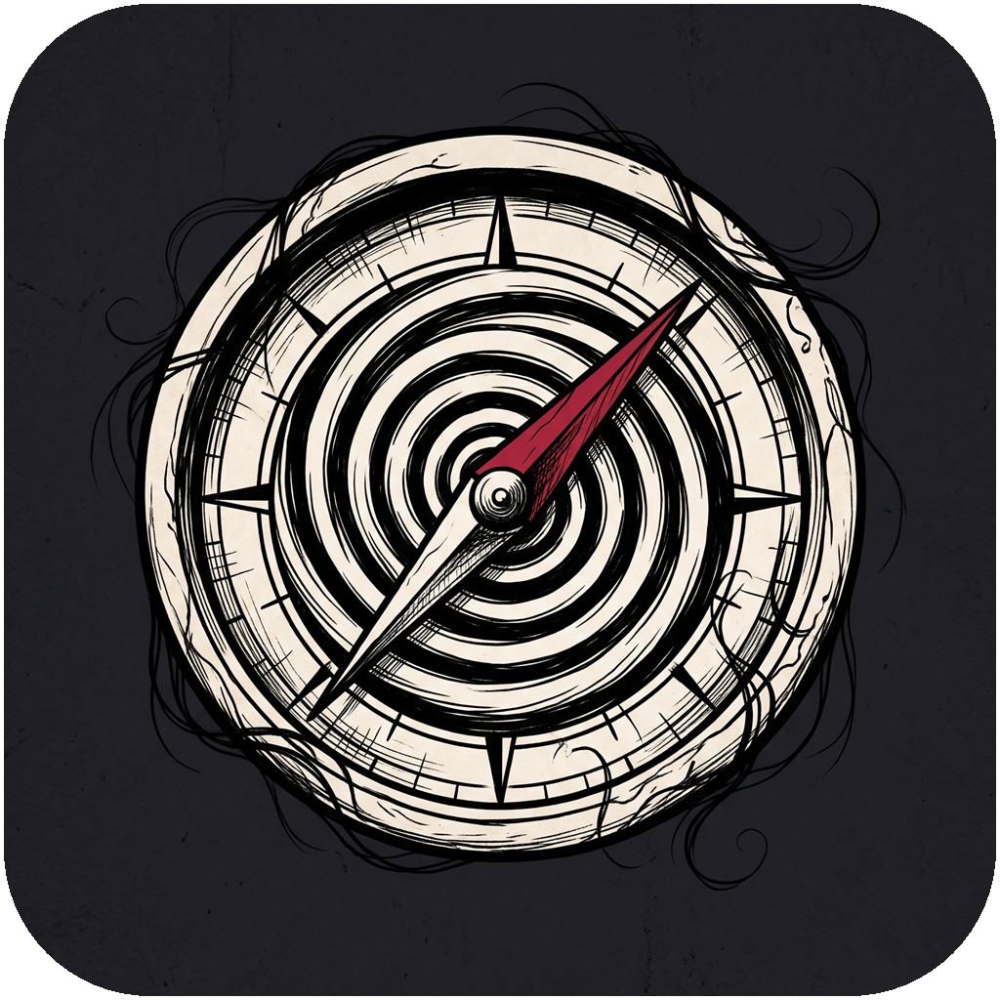
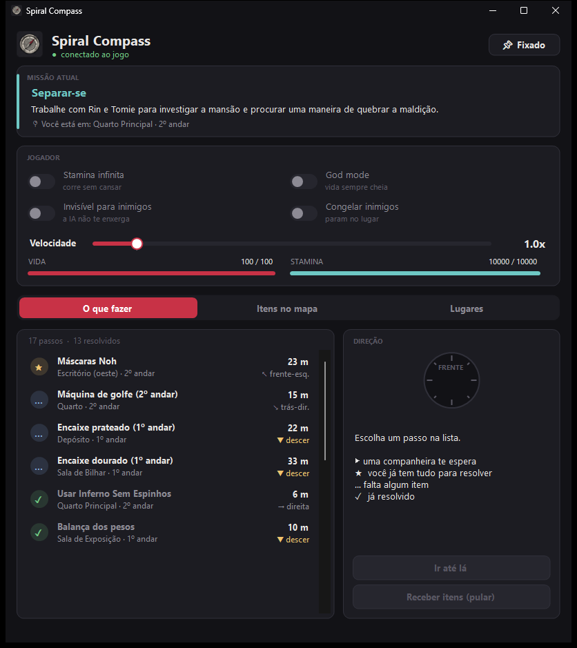

<p align="center">
  
</p>

<h1 align="center">Spiral Compass</h1>

<p align="center">
  Painel de cheats e guia de missões ao vivo para <b>Junji Ito Maniac: An Infinite Gaol</b> (single-player, PC/Steam).
  <br>
  <a href="README.md">🇺🇸 Read in English</a>
</p>

<p align="center">
  
</p>

## Funcionalidades

**Jogador**
- Stamina infinita
- God mode (vida sempre cheia)
- Invisível para inimigos (a IA não te enxerga)
- Congelar inimigos
- Velocidade de 0.5x a 5x

**Aba "O que fazer": guia da missão ao vivo**
- Mostra o título e a descrição da missão atual
- Lista cada passo com a situação: ▶ uma companheira te espera · ★ você já tem tudo para resolver · … falta algum item · ✓ já resolvido
- Soluções escritas para os enigmas do Capítulo 2 (balança, caixa do palhaço, máscaras Noh, máquina de golfe, encaixes dourado e prateado, cofrinho, portas trancadas), tiradas dos dados internos de cada enigma
- **Modo automático**: qualquer lugar do jogo que pede um item aparece sozinho, dizendo se você tem o item e onde ele está
- Lê o seu inventário: diz se cada item necessário está *com você*, *no mapa* (sala e andar) ou *ainda não disponível*

**Aba "Itens no mapa"**
- Todos os coletáveis que ainda estão no mapa, com nome, sala, andar e distância
- Aviso 🔒 quando o item provavelmente está atrás de uma porta trancada
- **Trazer item até mim**: o item vem até você e você pega normalmente (os eventos da história continuam funcionando)

**Aba "Lugares"**
- Teleporte para 40 lugares: todas as salas do 1º e 2º andar, sótão, quartos seguros, jardim, chalé do jardim e porões
- Pede confirmação antes de ir para áreas de outros capítulos

**Em todas as abas**
- Bússola que aponta para o alvo selecionado em relação à sua câmera, avisando se é para subir ou descer de andar
- Teleporte inteligente: procura espaço livre em volta do alvo e já vira a câmera para ele
- **Receber itens (pular)**: coloca os itens que faltam direto no inventário, pelo cheat manager de debug dos próprios desenvolvedores, para quando você estiver travado

## Requisitos

- Windows 10 ou 11
- *Junji Ito Maniac: An Infinite Gaol* (Steam, testado na v1.1.2, Unreal Engine 5.5)
- [UE4SS **experimental**](https://github.com/UE4SS-RE/RE-UE4SS/releases/tag/experimental-latest) (a versão estável 3.0.1 não suporta UE 5.5)
- .NET Framework 4.x (já vem com o Windows)

## Instalação

1. **Instale o UE4SS**
   - Baixe o `UE4SS_v3.0.1-....zip` da [versão experimental](https://github.com/UE4SS-RE/RE-UE4SS/releases/tag/experimental-latest).
   - Extraia o `dwmapi.dll` e a pasta `ue4ss` em `...\steamapps\common\JIM\JIM\Binaries\Win64\`.
   - Deixe `GuiConsoleEnabled = 0` no `ue4ss\UE4SS-settings.ini` (veja [Problemas comuns](#problemas-comuns)).
2. **Baixe o Spiral Compass**
   - Pegue a última [release](../../releases), **ou** clone o repositório e rode o `build.bat`.
3. **Rode o `install.bat`.** Ele procura o jogo nas pastas comuns da Steam. Se não achar, passe o caminho:
   ```bat
   install.bat "D:\SteamLibrary\steamapps\common\JIM"
   ```
4. **Jogue:** abra o jogo, carregue o save e abra
   `...\JIM\Binaries\Win64\ue4ss\Mods\SpiralCompass\SpiralCompass.exe`.
   O painel mostra **● conectado ao jogo** em verde.

> 💾 Faça backup dos seus saves antes de usar: `%LOCALAPPDATA%\JIM\Saved\SaveGames`

## Como funciona

```
 SpiralCompass.exe  ──cmd.txt──▶  mod Lua (UE4SS, dentro do jogo)  ──▶  reflexão do Unreal
  (painel WinForms)  ◀─state.txt──        lê / escreve pelo nome
```

- O **mod Lua** roda dentro do jogo pelo UE4SS e conversa com a engine pelo sistema de reflexão do Unreal.
  Ele acha tudo pelo nome (`GamePlayerCharacter`, `SetStamina`, `MechanicSystem`...), então não existem
  endereços de memória ou ponteiros que quebram quando o jogo reinicia.
- O **painel** é um programa C# separado. Os dois só trocam dois arquivos de texto pequenos na pasta do mod.
- Os nomes de itens, salas e missões vêm das próprias `DataTable`s e da `StringTable` do jogo.
- A situação de cada enigma vem do `MechanicSystem.MechanicStateMap`, a mesma fonte que o mapa do jogo usa para os marcadores "?" e ✓.
- Os nomes de sala usam uma calibração mundo → mapa tirada do widget de mapa do próprio jogo.

## Limitações conhecidas

- As **soluções escritas** cobrem o Capítulo 2. Os enigmas com item dos outros capítulos são listados automaticamente (o que usar e onde), mas sem solução escrita.
- Os **nomes de sala** existem só no 1º e 2º andar da mansão. Fora disso aparece só o andar.
- O god mode mantém a vida cheia, mas algumas animações de agarrão podem matar mesmo assim. Para essas, use **Congelar inimigos**.
- Teleportar para áreas que você ainda não liberou pode quebrar a ordem da história. O painel avisa, mas use com cuidado.

## Problemas comuns

| Problema | Solução |
|---|---|
| Jogo crasha com `DiscordHook64.dll` no crash dump | O overlay do Discord conflita com a janela de debug do UE4SS. Deixe `GuiConsoleEnabled = 0` ou desative o overlay do Discord para este jogo. |
| Painel parado em "aguardando o jogo" | Confira se o `ue4ss\UE4SS.log` tem `[SpiralCompass] carregado` e se o `SpiralCompass.exe` está dentro da pasta `Mods\SpiralCompass`. |
| Missão aparece "—" | Abra o mapa do jogo uma vez. Depois disso a missão fica guardada. |
| "Teleporte bloqueado" | O jogo recusou o ponto (sem espaço livre). Escolha um alvo próximo ou use **Trazer item até mim**. |

## Desinstalar

Apague a pasta `ue4ss\Mods\SpiralCompass`. Para tirar o UE4SS também, apague o `dwmapi.dll` e a pasta `ue4ss` de `JIM\Binaries\Win64`.

## Estrutura do projeto

```
mod/SpiralCompass/Scripts/main.lua   lado do jogo (mod Lua do UE4SS)
mod/SpiralCompass/enabled.txt        faz o UE4SS carregar o mod automaticamente
panel/SpiralCompass.cs               painel (C# 5 / WinForms, sem dependências)
panel/icon.ico                       ícone do programa
tools/                               scripts de pesquisa usados para mapear o jogo (veja tools/README.md)
build.bat / install.bat              compilar e instalar
```

## Aviso

Ferramenta não oficial, feita por fã, **apenas para uso single-player**. Não tem vínculo nem aprovação dos desenvolvedores ou
publicadores do jogo, nem de Junji Ito. Nenhum arquivo ou asset do jogo é distribuído neste repositório. Use por sua conta e risco.
